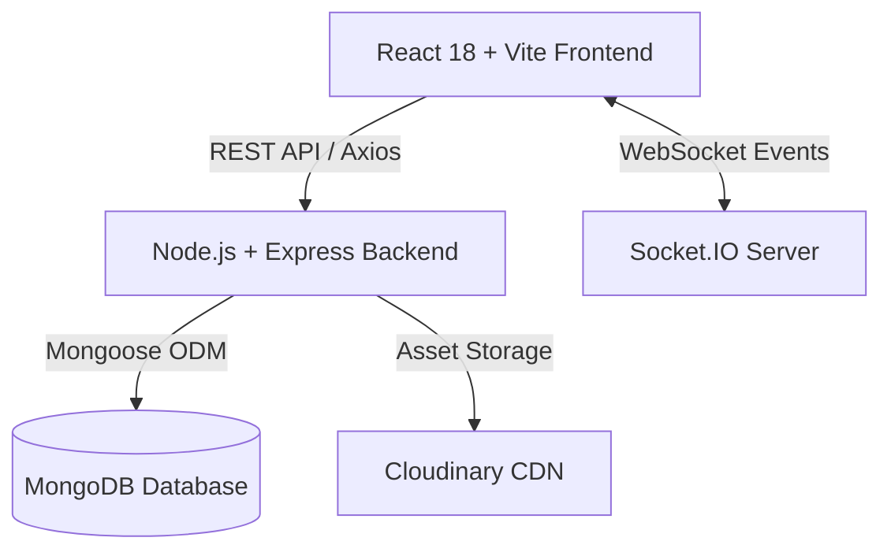

# 🏥 Appointment Management System

A production-ready full-stack MERN (MongoDB, Express, React, Node.js) web application for booking appointments, managing medical schedules, and coordinating consultations with real-time Socket.IO notifications.


---

## 📋 Table of Contents

- [Features](#-features)
- [Architecture & Tech Stack](#-architecture--tech-stack)
- [Project Structure](#-project-structure)
- [Prerequisites](#-prerequisites)
- [Installation & Setup](#-installation--setup)
- [Configuration (.env)](#-configuration-env)
- [Running the Application](#-running-the-application)
- [API Endpoints](#-api-endpoints)
- [Database Schema](#-database-schema)
- [Real-time System](#-real-time-system)
- [Branching & Contributing](#-branching--contributing)
- [License](#-license)

---

## ✨ Features

### 👤 Patient Experience
- **Authentication**: Secure JWT registration, sign-in, and session persistence.
- **Doctor Discovery**: Search and view certified medical doctors with specializations and ratings.
- **Appointment Scheduling**: Real-time slot booking with instant confirmation.
- **Patient Dashboard**: Manage upcoming consultations, check appointment status, and view past medical history.
- **Profile Customization**: Update personal info, medical notes, and upload profile pictures.

### 🩺 Healthcare Professional / Doctor Portal
- **Doctor Onboarding**: Specialized onboarding flow capturing qualifications, department, and clinic hours.
- **Schedule Management**: Set availability windows and manage conflicting appointments.
- **Real-Time Consultations Feed**: Instant Socket.IO notifications upon patient booking.
- **Status Updates**: Mark consultations as confirmed, completed, or cancelled with automated status sync.

### 🛡️ Core Security & Performance
- **Role-Based Access Control (RBAC)**: Secure routes for Patients, Doctors, and Administrators.
- **Password Protection**: Salted bcrypt password hashing.
- **Cloud Media Storage**: Secure asset uploads with Cloudinary and Multer.

---

## 🛠️ Architecture & Tech Stack



### Frontend
- **React 18** & **Vite** - High-speed frontend bundling and rendering
- **Tailwind CSS** & **Material-UI (MUI)** - Modern responsive UI design
- **Zustand** - Lightweight global state management
- **React Router v6** - Client-side page navigation with protected route guards
- **Socket.IO Client** - Live event streaming
- **React Hot Toast** - Toast feedback notifications

### Backend
- **Node.js** & **Express** - Modular REST API architecture
- **MongoDB** & **Mongoose** - Document data modeling with schema validation
- **Socket.IO** - Real-time bi-directional messaging
- **JSON Web Tokens (JWT)** - Stateless authentication
- **Multer** & **Cloudinary** - Image processing and CDN distribution

---

## 📁 Project Structure

```
Appointment-management-system/
├── backend/
│   ├── index.js                 # Server entry point & Socket.IO server
│   ├── package.json             # Backend dependencies & scripts
│   ├── middleware/
│   │   └── auth.js              # JWT auth and RBAC middleware
│   ├── models/
│   │   ├── User.js              # User schema (Patient/Doctor/Admin)
│   │   └── Appointment.js       # Appointment booking schema
│   ├── routes/
│   │   ├── auth.js              # Auth & profile management routes
│   │   ├── appointments.js      # Booking & status endpoints
│   │   └── doctors.js           # Doctor directory & schedule endpoints
│   └── utils/
│       └── cloudinary.js        # Cloudinary SDK & Multer storage configuration
│
├── frontend/
│   ├── index.html               # Main HTML entry
│   ├── package.json             # Frontend dependencies
│   ├── vite.config.js           # Vite build config
│   ├── tailwind.config.js       # Tailwind CSS design system
│   └── src/
│       ├── main.jsx             # React DOM root
│       ├── App.jsx              # App routes & provider container
│       ├── index.css            # Global Tailwind styling
│       ├── components/
│       │   ├── Navbar.jsx       # Global responsive header
│       │   ├── ProtectedRoute.jsx # Route authentication guard
│       │   └── ImageUpload.jsx  # Cloudinary file uploader
│       ├── pages/
│       │   ├── Home.jsx         # Landing page
│       │   ├── Login.jsx        # User login
│       │   ├── Register.jsx     # Patient registration
│       │   ├── DoctorRegister.jsx # Doctor onboarding
│       │   ├── UserDashboard.jsx  # Patient appointment manager
│       │   ├── DoctorDashboard.jsx# Doctor appointment schedule
│       │   ├── Settings.jsx     # Profile & preferences
│       │   ├── About.jsx        # About platform
│       │   └── Contact.jsx      # Support & contact page
│       └── store/
│           └── authStore.js     # Zustand authentication store
│
├── .env.example                 # Root environment variable template
├── .gitignore                   # Ignored files (node_modules, env, build)
└── README.md                    # Project documentation
```

---

## 📦 Prerequisites

Ensure you have the following installed locally:
- [Node.js](https://nodejs.org/) (version 16.x or later)
- [npm](https://www.npmjs.com/) (version 8.x or later)
- [MongoDB](https://www.mongodb.com/) (running locally or MongoDB Atlas connection string)
- [Cloudinary](https://cloudinary.com/) free tier account for media uploads

---

## 🚀 Installation & Setup

### 1. Clone the Repository
```bash
git clone https://github.com/KrupThakkar/Appointment-management-system.git
cd Appointment-management-system
```

### 2. Install Dependencies

**Backend:**
```bash
cd backend
npm install
```

**Frontend:**
```bash
cd ../frontend
npm install
```

---

## ⚙️ Configuration (.env)

Create a `.env` file in `backend/`:

```env
PORT=5000
NODE_ENV=development
CLIENT_URL=http://localhost:5173

# Database
MONGO_URI=mongodb://localhost:27017/appointment-system

# Authentication
JWT_SECRET=your_super_secret_jwt_key_change_in_production

# Cloudinary Storage
CLOUDINARY_CLOUD_NAME=your_cloudinary_cloud_name
CLOUDINARY_API_KEY=your_cloudinary_api_key
CLOUDINARY_API_SECRET=your_cloudinary_api_secret
```

Create a `.env` file in `frontend/`:

```env
VITE_API_URL=http://localhost:5000
VITE_SOCKET_URL=http://localhost:5000
```

---

## ▶️ Running the Application

### Option A: Run Separately (Recommended for Development)

**Terminal 1: Start Backend**
```bash
cd backend
npm start
```
*Server starts on `http://localhost:5000`*

**Terminal 2: Start Frontend**
```bash
cd frontend
npm run dev
```
*Vite dev server starts on `http://localhost:5173`*

---

## 📡 API Endpoints

### Authentication (`/api/auth`)
| Method | Endpoint | Description | Access |
|---|---|---|---|
| `POST` | `/api/auth/register` | Register a new patient account | Public |
| `POST` | `/api/auth/doctor-register` | Register a new doctor account | Public |
| `POST` | `/api/auth/login` | Authenticate user & return JWT | Public |
| `GET` | `/api/auth/profile` | Retrieve authenticated profile | Private |
| `PUT` | `/api/auth/profile` | Update profile information | Private |

### Appointments (`/api/appointments`)
| Method | Endpoint | Description | Access |
|---|---|---|---|
| `GET` | `/api/appointments` | Get appointments for active user | Private |
| `POST` | `/api/appointments` | Schedule a new appointment | Patient |
| `PUT` | `/api/appointments/:id` | Update appointment details | Private |
| `DELETE` | `/api/appointments/:id` | Cancel an appointment | Private |
| `PATCH` | `/api/appointments/:id/complete` | Mark consultation completed | Doctor |

### Doctors (`/api/doctors`)
| Method | Endpoint | Description | Access |
|---|---|---|---|
| `GET` | `/api/doctors` | List all available doctors | Public |
| `GET` | `/api/doctors/:id` | Get single doctor details | Public |
| `GET` | `/api/doctors/:id/schedule` | Retrieve doctor's timetable | Public |
| `PUT` | `/api/doctors/:id/availability` | Update doctor consultation hours | Doctor |

---

## 💾 Database Schema

### User Schema (`models/User.js`)
```javascript
{
  name: { type: String, required: true },
  email: { type: String, required: true, unique: true },
  password: { type: String, required: true },
  role: { type: String, enum: ['patient', 'doctor', 'admin'], default: 'patient' },
  phone: { type: String },
  specialization: { type: String }, // For doctors
  experience: { type: Number },     // For doctors
  fees: { type: Number },           // For doctors
  profileImage: { type: String },
  createdAt: { type: Date, default: Date.now }
}
```

### Appointment Schema (`models/Appointment.js`)
```javascript
{
  patient: { type: mongoose.Schema.Types.ObjectId, ref: 'User', required: true },
  doctor: { type: mongoose.Schema.Types.ObjectId, ref: 'User', required: true },
  date: { type: Date, required: true },
  time: { type: String, required: true },
  status: { type: String, enum: ['pending', 'confirmed', 'completed', 'cancelled'], default: 'pending' },
  symptoms: { type: String },
  notes: { type: String },
  createdAt: { type: Date, default: Date.now }
}
```

---

## 🔄 Real-time System

The application integrates **Socket.IO** for live appointment lifecycle updates:
- **`appointment_booked`**: Sent to the corresponding doctor immediately when a patient books a slot.
- **`status_updated`**: Broadcast to the patient whenever a doctor confirms, completes, or cancels a session.
- Real-time client listeners automatically re-fetch schedules and update UI dashboards without full-page reloads.

---

## 🌿 Branching & Contributing

This project uses Git Flow best practices:
- **`main`**: Production-ready releases (`v1.0.0`)
- **`develop`**: Integration branch for tested features
- **`feature/*`**: Dedicated feature branches (e.g. `feature/backend-api`, `feature/frontend-ui`)

### Standard Workflow
1. Fork the repo & clone locally
2. Create your feature branch (`git checkout -b feature/new-capability`)
3. Commit your changes with descriptive messages (`git commit -m "feat: add appointment reminders"`)
4. Push to branch (`git push origin feature/new-capability`)
5. Open a Pull Request into `develop`

---

## 📄 License

Distributed under the MIT License. See `LICENSE` for more information.
